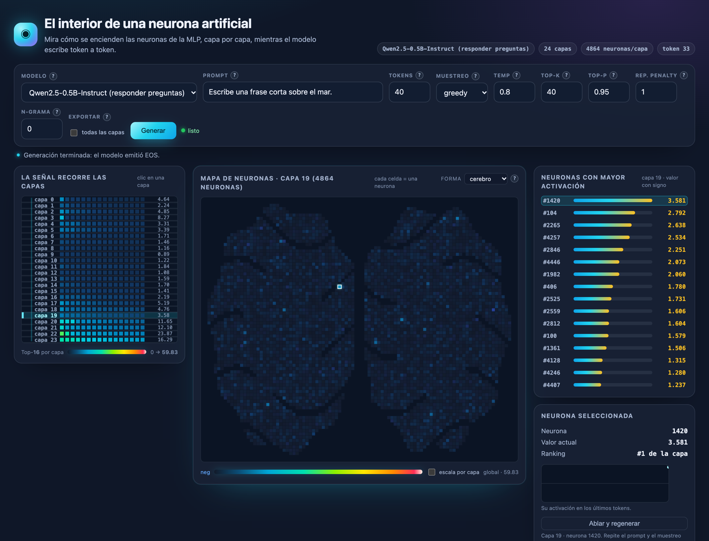
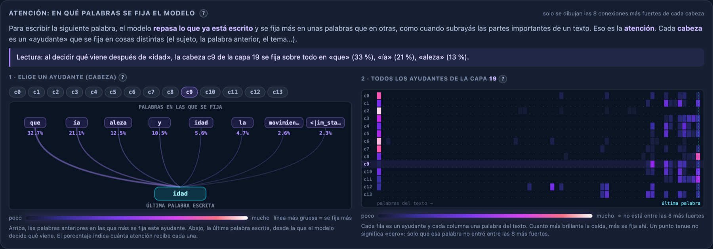

# Visualizador de activación neuronal

[](https://github.com/siciliatech/visualizador-neuronas/actions/workflows/ci.yml)

**Mira dentro de un modelo de lenguaje mientras escribe.** Esta herramienta local muestra, en vivo y en
el navegador, qué neuronas se encienden en cada capa de un transformer cuando genera texto palabra por
palabra, en qué palabras se fija (atención) y qué pasa si se apaga una neurona (ablación). También
soporta modelos **MoE** (Mixture of Experts): muestra qué **expertos** elige el router en cada capa y
cuánto cómputo se ahorra (sin ahorrar memoria).



*Qwen2.5-0.5B-Instruct generando «El mar es un espectáculo inestimable…». El mapa muestra la capa 19 con
la forma de cerebro; el ranking y el panel derecho usan las activaciones reales de la MLP.*


Está pensada para **enseñar y explorar** cómo funciona un modelo de lenguaje, también para personas sin
formación en IA: cada control tiene un icono **?** con una explicación breve, y hay una
[guía para docentes](docs/guia-docente.md) y un [guion de video](docs/guion-video.md).

Técnicamente es una herramienta de **interpretabilidad mecanicista**: captura la activación **real de
las neuronas de la MLP** con **TransformerLens** y la envía al navegador por WebSocket. No entrena ni
modifica el modelo; la ablación es una intervención temporal en memoria que se retira al terminar.

## Qué ofrece

| Función | Para qué sirve |
|---|---|
| **Punto de partida** | «¿Qué querés hacer?» propone dos recorridos: explorar un modelo o preparar una comparación A/B. Cada tarjeta muestra un resumen y despliega los pasos con **Ver más**; el recorrido de comparación activa la captura necesaria |
| **Mapa de neuronas** | Cada celda es una neurona de la capa elegida; el color indica cuánto se enciende. Forma a elección: cuadrícula, cerebro o chip (decorativa) |
| **Ruteo MoE** | En modelos Mixture of Experts, cada celda es un experto y el brillo es el peso que le dio el router; incluye carga acumulada y parámetros activos |
| **Recorrido por capas** | Ranking de las neuronas —o expertos— más activos de cada capa; un clic cambia la capa visible |
| **Atención explicada** | En qué palabras anteriores se fija cada «cabeza», con una frase de lectura en lenguaje llano |
| **Ayudas contextuales** | Icono **?** en cada control y gráfico, con qué es y para qué sirve |
| **Ablación** | Apaga una neurona —o quita un experto del ruteo— y compara el texto generado con y sin la intervención (con semilla reproducible) |
| **Comparación A/B** | Compara dos generaciones: diff por neurona/experto si es el mismo modelo, o métricas normalizadas (cómputo y ruteo) si son modelos o arquitecturas distintas |
| **Informe** | Resumen en lenguaje claro de lo ocurrido en cada generación |
| **Exportación** | Descarga las activaciones en CSV o Parquet |

## Contenido

[Inicio rápido](#inicio-rápido) · [Hardware](#hardware-necesario) · [Cómo funciona](#cómo-funciona) ·
[Modelos](#modelos-incluidos) · [Instalación](#instalación) · [Uso](#uso) ·
[Desarrollo](#desarrollo) · [Documentación](#documentación-adicional) · [Licencia](#licencia)

## Inicio rápido

Necesitas **Python 3.10 o superior**, unos **4 GB de RAM libres** y **~3 GB de disco** (ver
[hardware](#hardware-necesario)). No hace falta GPU.

```bash
# 1. Entorno virtual
python3 -m venv .venv
source .venv/bin/activate                # Windows: .venv\Scripts\activate

# 2. Dependencias (torch CPU primero para evitar descargar CUDA, ~3 GB)
pip install --index-url https://download.pytorch.org/whl/cpu torch==2.14.1
pip install -r requirements.txt

# 3. Arrancar
uvicorn server:app --port 8000
```

Abre <http://localhost:8000>, escribe un prompt y pulsa **Generar**. **La primera vez** el modelo se
descarga desde Hugging Face (~1 GB para Qwen) y la primera generación tarda varios minutos; las
siguientes arrancan al instante porque el modelo queda en la caché local.

> Con Docker: `docker compose up --build` y abre <http://localhost:8000> (ver [Con Docker](#con-docker)).
>
> Para usarlo en clase sin conexión, genera una vez con cada modelo **antes** para que queden descargados.

## Hardware necesario

El visualizador corre **en CPU**, sin GPU. Lo que más pesa es la memoria del modelo cargado.

| Recurso | Mínimo | Recomendado |
|---|---|---|
| **Memoria RAM total** | 8 GB | 16 GB |
| **Procesador** | 4 núcleos, 64 bits (x86-64 o ARM/Apple Silicon) | 8 núcleos o más |
| **Disco libre** | 3 GB | 5 GB (si usas los 4 modelos) |
| **GPU** | No necesaria | No necesaria |
| **Sistema operativo** | macOS, Linux o Windows con Python 3.10+ | macOS, Linux o Windows (WSL2) |
| **Navegador** | Chrome, Edge, Firefox o Safari recientes | Chrome o Edge |
| **Red** | Solo para la primera descarga de cada modelo | — |

**Memoria que usa el servidor** (medida en el proceso, sin contar el navegador ni el sistema):

| Modelo | Tras cargar | Pico con 512 tokens |
|---|---|---|
| GPT-2 (124M) | ~1,2 GB | ~1,4 GB |
| Qwen2.5-0.5B-Instruct | ~2,3 GB | ~2,7 GB |
| Pythia-410m | no medido; estimado 2–3 GB (410M parámetros en `float32`) | no medido |
| Mixtral 8xTiny (MoE) | < 1 GB (0,5M parámetros + overhead de `transformers`) | no medido |

Solo hay **un modelo cargado a la vez**: al cambiar de modelo se descarga el anterior. Por eso 8 GB
alcanzan, pero el navegador y el sistema también consumen: con 8 GB conviene cerrar otras aplicaciones.

**Disco:** ~1 GB de dependencias de Python (con torch CPU) + ~1 GB por Qwen, ~550 MB por GPT-2, ~1 GB
por Pythia y unos pocos MB por Mixtral 8xTiny. Docker suma la imagen (~1,5 GB).

**Memoria del navegador:** la exportación con **todas las capas** y la comparación A/B guardan las
activaciones en el navegador. Para generaciones largas puede llegar a cientos de MB; guardar A y B
duplica ese consumo.

**Velocidad orientativa:** en un Apple M5 (10 núcleos, 16 GB), Qwen2.5-0.5B genera 40 tokens en unos
**19 segundos** (incluye capturar y enviar todas las activaciones); GPT-2 es varias veces más rápido. En
un procesador de menos núcleos o más antiguo espera tiempos mayores. Una sola generación a la vez: no
está pensado para varios usuarios simultáneos.

## Cómo funciona

```
prompt ──▶ server.py (FastAPI)
             │  1. carga el modelo con TransformerBridge.boot_transformers
             │  2. prefill con run_with_cache; cada token nuevo reutiliza el KV cache
             │  3. guarda la activación del ÚLTIMO token (d_mlp floats)
             │     o, en capas MoE, el peso del router por experto + el top-k elegido
             │  4. atención de la última query: top-8 conexiones por cabeza
             ▼  WebSocket /ws  →  {delta, layer, activations, stats, top, attention, routing}
        index.html (canvas)
             │  overview: Top-16 neuronas/expertos por valor con signo (clic para cambiar de capa)
             │  heatmap:  todas las neuronas o expertos de la capa seleccionada
             │  ruteo MoE: expertos por capa, carga acumulada y parámetros activos
             │  atención: conexiones reales por cabeza + mapa de cabezas
             └  top-k / detalle / stream de texto / informe
```

La neurona capturada es la **post-activación de la MLP** (antes de `down_proj`). En arquitecturas con
compuerta (Qwen/LLaMA/Gemma) ese hook ya es `act(gate_proj(x)) * up_proj(x)`, es decir la **neurona
completa**, no solo la compuerta. En una capa MoE la unidad visualizable no es una neurona interna: es
el **experto**, representado por el peso que el router le asigna al último token.

## Modelos incluidos

| Clave | Modelo | Arquitectura | Uso |
|---|---|---|---|
| `qwen2.5-0.5b-instruct` (por defecto) | Qwen2.5-0.5B-Instruct | densa | responde preguntas (chat template) |
| `gpt2` | GPT-2 base (124M) | densa | continúa texto |
| `pythia-410m` | EleutherAI Pythia-410m | densa | continúa texto |
| `mixtral-tiny` | `yujiepan/mixtral-8xtiny-random` | **MoE** (8 expertos, top-k aprendido) | observar ruteo; los pesos son aleatorios |

> **Sobre `mixtral-tiny`:** es un modelo **didáctico y sin entrenar**. No produce texto coherente: sirve
> para ver el mecanismo MoE con 2 capas, `d_model=8`, 8 expertos y ~0,5M de parámetros, sin GPU. El
> router real de Mixtral, OLMoE o un denso de 8B queda para una fase con GPU (ver
> [Limitaciones conocidas](#limitaciones-conocidas)).

Se carga **un solo modelo en memoria** a la vez: al cambiar de modelo se descarga el anterior para no
agotar la RAM. La primera vez que se usa un modelo, Hugging Face lo descarga a la caché local; según la
conexión puede tardar varios minutos. El servidor avisa con un mensaje `loading` y la UI muestra
`cargando …` mientras tanto.

## Instalación

Resumen en [Inicio rápido](#inicio-rápido). Detalles:

- **Python 3.10+.** El `Dockerfile` usa 3.14 y la CI 3.12. Comprueba tu versión con `python3 --version`.
- **`torch` primero, desde el índice CPU.** Evita las ruedas con CUDA (~3 GB) que `pip` bajaría por
  defecto. Si ya tienes `torch` instalado, `pip install -r requirements.txt` lo reutiliza.
- Las versiones de `requirements.txt` están fijadas y se probaron con `transformer-lens 4.2.0`.

```bash
python3 -m venv .venv
source .venv/bin/activate                # Windows: .venv\Scripts\activate
pip install --index-url https://download.pytorch.org/whl/cpu torch==2.14.1
pip install -r requirements.txt
```

### Si algo falla

| Síntoma | Causa probable y solución |
|---|---|
| `ModuleNotFoundError: transformer_lens` | No instalaste `requirements.txt` o el entorno virtual no está activo |
| La primera generación «no avanza» | Se está descargando el modelo; mira el estado `cargando …` y espera |
| `MemoryError` o el sistema se pone lento | Falta RAM: cierra aplicaciones o usa **GPT-2**, que consume menos |
| El puerto 8000 está ocupado | Arranca con otro puerto: `uvicorn server:app --port 8001` |
| La página carga pero dice «desconectado» | El servidor no está corriendo o abriste el HTML como archivo; entra por `http://localhost:8000` |
| Sin internet en el aula | Descarga los modelos antes: genera una vez con cada uno con conexión |

## Arranque

```bash
uvicorn server:app --port 8000                    # solo tu equipo (recomendado)
uvicorn server:app --host 0.0.0.0 --port 8000     # visible para otros equipos de la red (p. ej. un aula)
```

Abre <http://localhost:8000>. La primera generación tardará lo que tarde en descargar el modelo.

> La aplicación **no tiene autenticación**. Con `--host 0.0.0.0` cualquiera en tu red puede usarla y
> consumir la CPU y la RAM del equipo; úsalo solo en redes de confianza. Docker publica el puerto 8000
> en todas las interfaces por defecto.

### Con Docker

```bash
docker compose up --build      # la primera vez descarga el modelo dentro del volumen
# abrir http://localhost:8000
docker compose down            # los modelos quedan en el volumen hf-models
docker compose down -v         # borra también los modelos
```

## Desarrollo

Instala las dependencias de desarrollo (incluye `pytest`, `ruff` y Playwright) después de torch CPU:

```bash
pip install --index-url https://download.pytorch.org/whl/cpu torch==2.14.1
pip install -r requirements-dev.txt

ruff check .
ruff format --check .
pytest -q                 # unitarios; excluye slow y ui
pytest -q -m slow         # integración real con GPT-2 (descarga/carga el modelo)
pytest -q -m ui           # frontend con Chrome/Chromium; no carga modelos
```

La configuración de Ruff y pytest vive en `pyproject.toml`. El test `slow` carga GPT-2 de verdad y
comprueba el forward y la reutilización del KV cache. El test `ui` sirve `index.html`, sustituye el
WebSocket por un doble controlable y comprueba la ablación con semilla sin levantar FastAPI ni descargar
modelos. Si no hay Chrome instalado, Playwright puede usar su propio Chromium:

```bash
python -m playwright install chromium
```

Para comprobar el protocolo WebSocket contra un servidor en marcha:

```bash
# en otra terminal: uvicorn server:app --port 8000
python scripts/smoke_ws.py --model gpt2 --tokens 3
```

El smoke test valida el protocolo 2: `meta` con `protocol`/`selected_layer`, `step` con una sola capa
(la seleccionada) o todas con `--capture-all`, `stats` globales, `top` completo y `done`; también
comprueba que ningún delta contiene `�` y que el stream acumulado coincide con `done.generated_text`. Con
`--layer N` prueba además el cambio de capa en vivo:

```bash
python scripts/smoke_ws.py --model gpt2 --tokens 3 --layer 5
```

Con `--capture-all` el script comprueba además que cada `step` incluya **todas las capas** (el modo que
usa la exportación CSV/Parquet):

```bash
python scripts/smoke_ws.py --model gpt2 --tokens 2 --capture-all
```

Con `--ablate CAPA:NEURONA` comprueba además que `meta.ablation` coincida y que la neurona apagada
llegue a `0` en la capa visible:

```bash
python scripts/smoke_ws.py --model gpt2 --tokens 2 --layer 0 --ablate 0:100
```

## Uso

Al abrir la página, la sección **¿Qué querés hacer?** propone dos recorridos: **Ver un modelo
trabajando** (exploración libre) y **Comparar dos pasadas**. Cada tarjeta arranca colapsada con un
resumen y un botón **Ver más** que despliega los pasos. El recorrido de comparación activa «todas las
capas» por vos y recuerda los pasos: generar A, pulsar **Guardar A**, generar B y pulsar **Comparar**.
La elección solo prepara la interfaz; no genera nada por sí sola.

1. Elige el **modelo** en el desplegable.
2. Escribe un **prompt** y el número de **tokens** a generar (1–100).
3. Ajusta el muestreo: `mode` (muestreo/greedy), `temperature`, `top_k`, `top_p`,
   `repetition_penalty` y `no_repeat_ngram`. Si vas a exportar varias capas o comparar dos pasadas,
   marca **todas las capas** en «Capturar todo» antes de generar.
4. Pulsa **Generar**. Si no conoces un control, pulsa su icono **?** (Modelo, Prompt, Tokens,
   Muestreo, Temp, Top-k, Top-p, Rep. penalty, N-grama, Capturar todo): se abre una explicación breve de qué
   es y para qué sirve; se cierra con clic fuera o Esc.
5. En el heatmap, **clic en una fila** del overview (izquierda) para seleccionar la capa mostrada;
   pasa el ratón por el heatmap para ver capa/neurona/valor exactos. La casilla **escala por capa**
   ajusta los colores al máximo de la capa visible si una activación extrema aplana el mapa. El
   selector **Forma** reparte las neuronas en una cuadrícula (por defecto), un cerebro o un chip;
   es solo decorativo: el lugar de cada neurona en el dibujo es arbitrario.
6. Haz **clic en una neurona** del heatmap o del ranking para ver su valor, su posición y su
   **historial de activación token a token**. En un modelo MoE, cada celda es un **experto** y el valor
   es el peso que le dio el router. El panel «¿Qué estoy viendo?» se adapta a la arquitectura.
7. En el panel de **atención**, elige una cabeza (`c0`…`c13`) o haz clic en su fila del mapa para ver
   sus conexiones más fuertes con los tokens anteriores.
8. Al terminar, el **informe** explica en lenguaje claro qué pasó: capa y neurona (o experto) con mayor
   |activación| (magnitud y signo), capa con mayor media de |activación|, atención más fuerte dentro
   del top-8 enviado, **todos** los parámetros de muestreo y por qué terminó la generación. En MoE añade
   el reparto de cómputo activo y una lectura del ruteo.
9. Si activaste **todas las capas**, pulsa **CSV capa** para descargar la capa visible, **CSV todas**
   para descargar todas las capas en un único CSV o **Parquet** para descargar todas las capas en formato
   columnar.
10. Para **comparar dos pasadas**, activa **todas las capas** en ambas, genera la primera y pulsa
    **Guardar A**; después cambia el prompt o los parámetros, vuelve a generar y pulsa **Comparar**.
    El panel muestra las 12 neuronas con mayor cambio y permite elegir entre la **media de la
    generación**, un **paso concreto por posición** o un **token coincidente por contenido**;
    **Ver diff en heatmap** lleva el diferencial al mapa principal. Ambas pasadas deben usar el mismo
    modelo y la misma arquitectura; comparar un denso contra un MoE todavía no está disponible.
11. Para probar una neurona, selecciónala y pulsa **Ablar y regenerar**: se repite la pasada normal con
    esa neurona MLP forzada a cero y el panel compara el texto base con el ablacionado. En MoE el botón
    es **Apagar experto y regenerar** y el experto se quita del ruteo.

Los valores iniciales del muestreo son `temperature=0.8`, `top_k=40`, `top_p=0.95`,
`repetition_penalty=1.15` y `no_repeat_ngram=0`. `top_p=1` desactiva el filtro nucleus;
`no_repeat_ngram=0` (o `1`) desactiva la prohibición de repetir n-gramas y `N≥2` la activa.

Junto al botón **Generar** hay un badge con el estado del modelo: `sin cargar`, `cargando …`
(descarga/carga los pesos la primera vez) y `listo`. El mensaje bajo los controles da el detalle.

Por defecto, la escala de color es **global al paso** (0 → máximo absoluto del paso), con los valores
negativos en azul. **Escala por capa** usa el máximo absoluto de la capa visible y ayuda a distinguir
activaciones pequeñas cuando otra capa tiene un valor atípico. La leyenda muestra el máximo usado.
Con esta opción los colores ya no permiten comparar magnitudes entre capas; los valores numéricos,
el ranking, el informe y las exportaciones no cambian. En el modo diff la escala propia de `máx |Δ|`
se mantiene y la opción queda desactivada.

El overview y el ranking de neuronas ordenan por el **valor de activación con signo** (de mayor a
menor); el ancho de las barras usa `|v|` solo como escala visual. El informe, en cambio, busca la mayor
**magnitud** `|activación|`, así que puede destacar una neurona muy negativa que no encabeza el ranking.

La sección de atención abre con una explicación en lenguaje llano (las cabezas como «ayudantes» que
se fijan en palabras distintas), una frase de **Lectura** que resume en palabras la cabeza elegida
(«se fija sobre todo en…») y iconos **?** en cada gráfico. En el mapa de atención solo se dibujan las **8 conexiones más fuertes por cabeza**. Las celdas que
quedan fuera de ese top-8 llevan un punto tenue: no son atención cero y el tooltip lo indica como
«fuera del top-8». Los tokens especiales de los modelos chat (`<|im_start|>`, `<|endoftext|>`, etc.) se
etiquetan con su nombre en lugar de mostrarse como un espacio.



*La misma generación, cabeza `c9` de la capa 19. La frase de lectura traduce las conexiones más fuertes
a lenguaje llano; el mapa de la derecha muestra las 14 cabezas de la capa.*


Los canvas se dibujan a la resolución de `devicePixelRatio` (limitada a **2×** para no disparar el coste
en pantallas 3×) y la animación se limita a **~30 fps**. Así la atención no se redibuja en cada frame y
la vista se mantiene nítida en pantallas retina sin subir el uso de CPU.

### Ablar una neurona (o un experto)

La ablación permite pasar de *ver* una neurona a *intervenirla*. Después de una generación normal,
selecciona una neurona en el heatmap o en el ranking y pulsa **Ablar y regenerar** en el panel
«Neurona seleccionada». La aplicación vuelve a generar **con el mismo modelo, prompt y parámetros de la
última pasada normal**, pero fuerza a `0` esa neurona MLP en **todas las posiciones** de la generación.
El panel de ablación muestra el texto base y el texto nuevo lado a lado, con un aviso si son idénticos
o distintos.

En el servidor, la petición `generate` incluye un campo opcional:

```json
{"ablation": {"layer": 11, "neuron": 2910}}
```

`process_generate` valida que la capa y la neurona existan para el modelo cargado. Si no, devuelve un
`error` recuperable y no ejecuta ningún forward. Para una ablación válida, el servidor añade un hook
temporal a `blocks.{layer}.mlp.hook_post` que clona la activación y pone a cero solo esa neurona. El
hook se retira en un bloque `finally` después de cada forward, incluso si el modelo lanza un error, y
se aplica tanto al *prefill* como a los tokens que reutilizan el KV cache.

La captura de la pasada ablacionada es honesta: la neurona apagada aparece con valor `0` y el resto de
las activaciones son las que produjo el modelo con esa intervención. El texto base se conserva en
memoria del navegador; no se escribe nada en disco en el servidor. Al generar de nuevo sin ablación, el
panel se descarta y la nueva pasada normal pasa a ser la base.

Cada generación usa una **semilla**. Si el cliente no envía `seed`, el servidor elige una y la devuelve
en `meta.seed`; la UI la guarda con la pasada normal y la reutiliza al ablacionar. Así, con muestreo, la
comparación no mezcla dos ejecuciones independientes: la misma semilla y los mismos logits reproducen la
misma secuencia de elecciones. La ablación cambia los logits, pero el flujo aleatorio de partida es el
mismo. Para una lectura más simple, `greedy` sigue siendo la opción recomendada.

> Una neurona individual puede no cambiar el texto: en GPT-2 hay 3.072 neuronas por capa y muchas
> tienen un efecto pequeño o redundante. Que el texto sea idéntico **no** significa que la ablación
> fallara. Con muestreo, la semilla registrada hace que la comparación sea reproducible; aun así,
> `greedy` es más fácil de interpretar. La ablación apaga una neurona, no hace *activation patching* ni
> sustituye una activación por la de otro prompt.

### Modelos MoE: expertos y ruteo

En un transformer **denso**, todas las neuronas de la MLP se computan en cada token. En un modelo
**MoE** (Mixture of Experts) la capa contiene varios expertos y un **router** elige unos pocos
(`top-k`) por token; los demás no se computan. El visualizador adapta el mapa cuando el modelo cargado
es MoE:

- **La unidad del heatmap es el experto**, no una neurona interna. El valor de cada celda es el **peso
  que el router le dio al último token** (0 si no fue elegido). En `mixtral-tiny` hay 8 expertos por
  capa y se eligen 2.
- El panel **Ruteo MoE** dibuja una grilla `capas × expertos` con los elegidos encendidos, muestra la
  fracción `top-k / n_experts`, la **carga acumulada** durante la generación (qué expertos se repiten y
  cuáles quedan sin usar) y una estimación de **parámetros activos por token**.
- El ranking, el detalle, el tooltip, la exportación y el informe cambian sus etiquetas a «experto».
  En la exportación la columna sigue llamándose `neuron`, pero contiene el índice de experto.

El backend captura `blocks.{i}.mlp.hook_expert_indices` y `blocks.{i}.mlp.hook_expert_weights`, que en
TransformerLens 4.2 entregan `[tokens, top_k]` y `[tokens, n_experts]`. A diferencia del modo denso, en
MoE **no** se usa `pos_slice=-1`: ese recorte confunde la dimensión de expertos con la de secuencia y
dejaría los hooks mal recortados. `blocks.i.mlp.hook_post` no se usa para el mapa porque en MoE devuelve
`d_model` (la salida del bloque), no `d_mlp`.

**Qué significa «activo».** `active_params` estima los parámetros que participan por token descontando
los expertos no elegidos; no es una medición de tiempo ni de energía. En `mixtral-tiny` da ~98 % porque
los expertos son una fracción mínima del total: el dato es correcto, pero poco ilustrativo. En un MoE
grande la fracción baja y el ahorro de cómputo se vuelve visible. **La memoria no baja**: todos los
expertos siguen cargados aunque no se usen; lo que se ahorra es cómputo, no RAM/VRAM.

**Ablación de experto.** El botón **Apagar experto y regenerar** pone a cero el peso de ese experto en
`hook_expert_weights`. TransformerLens vuelve a derivar el top-k desde el tensor editado, así que el
router elige al siguiente mejor experto y la intervención quita al experto de la decisión (no solo
escala su salida). Consecuencia esperada: si el experto alternativo no estaba en el top-k original, el
segundo slot puede quedar con peso `0`. La semilla, el prompt y el muestreo se reutilizan igual que en
la ablación densa.

**Qué NO hace todavía.** La comparación A/B exige el mismo modelo, capas y unidades; **no** compara un
denso contra un MoE. Esa comparación cross-model necesita métricas normalizadas (ruteo, cómputo activo,
entropía) y quedó para la fase 2. Tampoco hay soporte GPU en esta versión: OLMoE, Mixtral real o un
denso de 8B no entran en el objetivo de 16 GB de RAM/CPU.

### Exportar activaciones

La generación normal envía solo la capa visible para mantener el payload pequeño. Para exportar cualquier
capa, marca **todas las capas** antes de generar: el servidor incluirá todas las activaciones en cada
`step`, el navegador las guarda en memoria y, al terminar, tienes tres botones:

- **CSV capa** descarga la capa que estés viendo;
- **CSV todas** descarga todas las capas en un único CSV, ordenado por capa, paso y neurona;
- **Parquet** descarga todas las capas en un único archivo columnar, con el mismo orden.

El CSV tiene una fila por neurona —o experto, en MoE—, capa y token generado:

```csv
step,token,layer,neuron,activation
1," la",0,0,0.123
1," la",0,1,-0.045
1," la",1,0,0.456
```

El nombre incluye modelo, alcance (`capa-N` o `todas-las-capas`) y fecha. La captura vive solo en la
pestaña hasta que generes de nuevo o la cierres; no se escribe nada en disco en el servidor. Activar
todas las capas aumenta el payload de cada `step` y la memoria del navegador. **CSV todas** y **Parquet**
pueden generar archivos grandes: si superan unas 2 millones de filas, la interfaz pide confirmación y
muestra el tamaño estimado antes de prepararlos.

El Parquet usa un único *row group*, columnas `required`, codificación `PLAIN` sin compresión y
*Data Page v1*. El navegador lo genera sin librerías externas, así que no hay CDN ni dependencia nueva.
El esquema es `step INT32`, `token BYTE_ARRAY (UTF8)`, `layer INT32`, `neuron INT32` y
`activation FLOAT`; se puede leer con pandas, pyarrow, DuckDB o Spark. Al no comprimir, el archivo es
mayor que un Parquet típico pero sigue siendo más compacto que el CSV completo.

### Comparar dos pasadas

La comparación reutiliza la captura de **todas las capas**. El flujo es:

1. Activa **todas las capas** y genera la pasada A.
2. Pulsa **Guardar A** en el informe. El comparador se abre en la pestaña **A**.
3. Cambia el prompt, los parámetros de muestreo, el modelo o varios a la vez y genera la pasada B
   (con **todas las capas** activado).
4. Pulsa **Comparar**. Se abre la pestaña **Comparar** con el resultado que corresponda (ver abajo).
5. Las pestañas **A** y **B** muestran un resumen de cada pasada por separado: modelo, arquitectura,
   texto, tokens, parámetros totales y activos, muestreo, ablación y, en MoE, la carga de expertos por
   capa. **Comparar** queda deshabilitada hasta que existan las dos pasadas.
6. Cambia de capa en el overview para recalcular la comparación; **Cerrar** oculta el panel.

#### Mismo modelo y arquitectura: diff por unidad

Si A y B usan el mismo modelo, la misma arquitectura y el mismo número de capas y unidades, la
pestaña **Comparar** muestra, para la capa visible, las 12 neuronas (o expertos) con mayor diferencia
absoluta de activación entre A y B, con sus valores y el signo de `Δ = B − A`.

En **Vista** elige **Media de la generación** para comparar el promedio de todos los tokens, un
**paso concreto por posición** para comparar la activación de esa posición en A y B, o un
**token coincidente por contenido**. En los modos por paso y por token, el desplegable indica qué
generó cada pasada y en qué posición. Pulsa **Ver diff en heatmap** para sustituir el mapa principal
por `Δ = B − A`; el ranking, el tooltip, el detalle y la sparkline pasan al mismo modo.
**Ver heatmap actual** lo restaura.

El modo **paso concreto** compara la **misma posición** de generación: si A y B generaron tokens
distintos, la tabla muestra ambos para que la comparación sea explícita. Solo se ofrecen pasos
presentes en las dos pasadas. El modo **por contenido** empareja tokens con el mismo texto mediante la
**subsecuencia común más larga**: puede comparar un token que aparece en posiciones distintas y
respeta el orden de generación; los tokens repetidos se emparejan en orden. Es una coincidencia exacta
del texto normalizado (sin espacios perimetrales), no una alineación semántica ni por subpalabras. Si
no hay tokens coincidentes, el grupo aparece deshabilitado. El modo **media** promedia por neurona a lo
largo de todos los tokens generados y permite comparar longitudes distintas, pero no distingue en qué
token ocurrió el cambio.

En el heatmap diferencial, el título indica la capa y la vista (media, paso o token), y la escala de
color usa el **máximo `|Δ|`** de esa capa y vista, no la escala global del token actual. El ranking
muestra las neuronas con mayor `|Δ|`; al seleccionar una, el detalle muestra `Δ B − A` y la sparkline
dibuja la diferencia por paso o por token coincidente. El botón **Ver diff en heatmap** solo está
disponible mientras la pestaña **Comparar** tiene un diff por unidad.

#### Modelo o arquitectura distintos: métricas normalizadas

Comparar un denso con un MoE, o dos modelos con distinto tamaño, **no** permite alinear neuronas ni
expertos por índice: la neurona 5 de un modelo y la 5 de otro no representan lo mismo, y en un MoE la
unidad del heatmap es el experto, no la neurona. En ese caso la pestaña **Comparar** muestra una tabla
de métricas normalizadas:

- modelo, arquitectura, capas y unidades por capa;
- tokens generados;
- parámetros totales y **parámetros activos por token** con su fracción activa (en un denso la
  fracción es 100 %; en un MoE indica el cómputo, no la memoria ocupada);
- top-k del router, cobertura media de expertos, entropía normalizada del ruteo y peso medio del
  experto más usado, con el detalle por capa y barras comparativas A/B.

La **cobertura** es la fracción de expertos que se usó al menos una vez; la **entropía** va de 0
(siempre el mismo experto) a 1 (reparto uniforme). En esta vista el heatmap diferencial y los
controles de **Vista** no aplican. Guardar A y B mantiene ambas capturas en memoria, por lo que el uso
de RAM es aproximadamente el doble que una sola generación con todas las capas.

## Endpoints

| Método | Ruta | Descripción |
|---|---|---|
| `GET` | `/` | sirve `index.html` |
| `GET` | `/models` | catálogo de modelos disponibles (JSON) |
| `GET` | `/health` | estado del proceso sin cargar ni descargar modelos: `{"status": "ok", "model_key": "gpt2", "ready": true}`; si no hay modelo, `model_key` es `null` y `ready` es `false` |
| `WS` | `/ws` | canal de generación: recibe `{prompt, tokens, model, params, seed, capture_all, ablation}` y `{type: "select_layer", layer: N}`; emite `meta` (protocolo 2, arquitectura, unidad, `n_experts`, `router_top_k`, `layers_meta`, `routing_available`, `active_params`, capa seleccionada, `capture_all`, `seed` y `ablation`), `step` (delta, capa visible o todas las capas si se pidió captura, `stats` globales, `top`, atención y `routing`), `layer` (respuesta al cambio de capa), `done` (texto completo, texto generado y motivo de parada), `queued` y `error` |

### Logs

El servidor usa `logging` (no `print`) y emite, con nivel `INFO` por defecto:

- tiempo de carga del modelo y número de capas/neuronas;
- cada forward con contexto, tokens de entrada, modo de caché (`prefill`, `reuse` u `off`) y duración;
- cada `step` con capa, longitud del contexto, delta y **tamaño real del payload** en bytes;
- el cierre de la generación con motivo y duración;
- los errores internos con traza completa (`logger.exception`).

`VISUALIZER_LOG_LEVEL=DEBUG` (o `WARNING`) ajusta el nivel. Los logs de descarga de Hugging Face se
mantienen en `WARNING` para no tapar los de la generación.

### Errores del WebSocket

El mensaje se valida con **Pydantic** antes de tocar el modelo. Si la petición no es válida, el servidor
responde y **mantiene la conexión abierta** para que se pueda corregir y reintentar:

```json
{"type": "error", "code": "invalid_request", "message": "Petición inválida — params.temperature: ...", "recoverable": true}
```

Un fallo interno (carga del modelo, OOM) envía `recoverable: false` y cierra con código **1011**. La UI
muestra el mensaje, deja el botón **Generar** habilitado y, tras la reconexión automática, permite
reintentar sin recargar la página.

### Capa visible y payload (protocolo 2)

El heatmap muestra **una sola capa**, así que el `step` ya no necesita enviar todas. `meta` declara
`"protocol": 2`, la capa inicial (`selected_layer`) y, para MoE, `"architecture": "moe"`, `"unit":
"expert"`, `n_experts`, `router_top_k`, `layers_meta` (unidades por capa), `routing_available` y
`active_params`. `layers_meta` permite capas híbridas: la UI consulta la unidad de cada capa en lugar de
asumir que todas son iguales. El cliente pide otra capa con:

```json
{"type": "select_layer", "layer": 5}
```

El servidor guarda la selección **por conexión** y responde con el último estado completo que conserva
en memoria, sin repetir el forward:

```json
{"type": "layer", "layer": 5, "activations": [0.12, -0.03, "..."]}
```

Los `step` siguientes traen solo `activations["layer_N"]`, el campo `"layer": N` y `stats` agregados de
**todas** las capas para que el informe conserve los récords globales:

```json
"stats": {
  "max_abs": {"value": 12.3, "layer": 5, "neuron": 912, "token": "..."},
  "max_signed": {"value": -12.3, "layer": 5, "neuron": 912, "token": "..."},
  "layer_means": {"layer_0": 0.42, "layer_5": 1.08}
}
```

En MoE, `activations["layer_N"]` es el vector de pesos del router (una posición por experto) y cada
`step` añade `routing` con la decisión del último token:

```json
"routing": {
  "layer_0": {
    "n_experts": 8,
    "top_k": 2,
    "experts": [6, 3],
    "weights": [0.61, 0.39],
    "entropy": 0.94
  }
}
```

`entropy` va de 0 (un experto concentra todo el peso) a 1 (reparto uniforme entre los top-k). El routing
viaja fuera de `attention` para no romper el contrato anterior.

Si el cliente envía `"capture_all": true`, `activations` incluye todas las capas para permitir la
exportación CSV/Parquet; `meta` repite `capture_all` para confirmar el modo. El campo opcional
`"ablation": {"layer": L, "neuron": N}` apaga esa neurona MLP —o interpreta `N` como experto si la capa
es MoE— durante la generación; `meta.ablation` repite la especificación aceptada o `null`. El campo
opcional `"seed": N` fija el muestreo; si se omite, el servidor genera una semilla aleatoria y la
publica en `meta.seed`.

`top` y `attention` siguen siendo completos: el overview y la vista de atención no cambian al cambiar de
capa. El clic en una fila del overview envía `select_layer`; mientras no llega la respuesta, el heatmap
mantiene la capa anterior en vez de quedar vacío. El frontend también acepta `step` del protocolo
anterior (todas las capas y sin `stats`) como red de seguridad durante la transición.

### Texto incremental

Cada `step` trae `delta` con el texto nuevo y `token` como alias temporal del mismo valor. El servidor
decodifica el prefijo generado completo y recorta los caracteres de reemplazo de bytes UTF-8 incompletos,
así que un carácter multibyte partido entre dos tokens (`¿`, `¡`, acentos, emojis) no muestra `�`:

```json
{"type": "step", "layer": 5, "delta": "¿", "token": "¿", "activations": {"layer_5": [...]}, "stats": {...}, "top": {...}, "attention": {...}}
```

Si `delta` es `""`, el token fue especial o solo aportó bytes que se completarán en el siguiente paso: la
UI cuenta el paso pero no añade texto al stream. Para el informe y las etiquetas de atención, el token
que completa un carácter recibe el texto y el token parcial queda vacío (la UI lo muestra como `␣`).
Los tokens especiales se etiquetan con su nombre real (`<|im_start|>`, `<|endoftext|>`, etc.).

Al cerrar, `done.text` es la decodificación segura de **prompt + generación** y `done.generated_text` es
solo lo generado. La UI usa este último para reconciliar el stream si hiciera falta.

### Concurrencia

El modelo se comparte entre conexiones, pero las generaciones se serializan: si otro cliente está
generando, el nuevo recibe un mensaje `queued` y espera su turno en vez de recibir datos mezclados.
La carga también tiene su propio lock, así que dos clientes que piden el mismo modelo no lo cargan dos
veces. Las activaciones, la atención y el estado de decodificación son locales a cada generación; solo
el modelo cargado (`bridge`/`tokenizer`) es compartido.

### Rendimiento

- El forward de calentamiento que calcula `meta` también produce los logits del primer token; se
  reutilizan y no se repite la pasada completa por el prompt.
- `run_with_cache(..., pos_slice=-1)` guarda activaciones y atención solo de la última query. Con GPT-2
  y un prompt de 401 tokens, el pico de RSS baja aproximadamente 50 MiB respecto de cachear todas las
  posiciones.
- **KV cache:** el prefill procesa el prompt completo y cada token siguiente reutiliza las claves/valores
  (`past_key_values`), así que el modelo ya no recalcula todo el contexto. En GPT-2 con 512 tokens de
  contexto medimos ~0,158 s por token con forward completo y ~0,012 s con KV cache (~13×). El flag
  `VISUALIZER_KV_CACHE=0` desactiva la ruta incremental; si un modelo no devuelve caché, el servidor
  vuelve automáticamente al forward completo.
- **Payload por capa:** cada `step` bajó de tamaño al enviar solo la capa visible. Medido con el smoke
  test (incluyendo `top` y `attention` completos): GPT-2 ~32–36 KiB por token (antes ~258 KiB, ~8× menos)
  y Qwen2.5-0.5B ~67 KiB (antes ~0,8 MB, ~12× menos). El cambio de capa no reenvía activaciones: usa el
  último estado que ya está en el servidor.
- **MoE:** el ruteo ocupa muy poco (`n_experts` floats por capa y token), pero en MoE no se aplica
  `pos_slice=-1`, así que el caché conserva las posiciones de la secuencia además de los hooks de
  ruteo. Con los modelos diminutos actuales el coste es despreciable; en un modelo grande conviene
  revisar el pico de memoria al cachear todas las posiciones.
- **Canvas:** el heatmap y la animación se redibujan como máximo a ~30 fps; la atención solo se redibuja
  cuando cambia (token, capa o cabeza), no en cada frame. Los canvas usan `devicePixelRatio` (máximo 2×)
  manteniendo el mismo tamaño CSS, así que se ven nítidos en retina sin multiplicar el coste por 3.

## Estructura

| Archivo | Rol |
|---|---|
| `server.py` | Backend FastAPI: carga del modelo, generación, captura de activaciones y WebSocket |
| `index.html` | Frontend autocontenido (HTML+CSS+JS, canvas puro, sin dependencias) |
| `requirements.txt` | Dependencias fijadas |
| `requirements-dev.txt` | Dependencias de desarrollo (pytest, ruff y Playwright) |
| `pyproject.toml` | Configuración de Ruff y pytest (marcadores `slow` y `ui`) |
| `scripts/smoke_ws.py` | Prueba de humo del WebSocket (`meta`/`layer`/`step`/`done`) |
| `tests/` | Tests unitarios de muestreo, truncado, decodificación incremental y tokens especiales, validación de mensajes, bucle de generación con KV cache, ablación densa y MoE, detección de arquitectura, ruteo, parámetros activos, cambio de capa por WebSocket, `/health` y tamaño de payload; `test_integration_slow.py` carga GPT-2 real y `test_frontend_ablation.py` prueba la UI con un WebSocket simulado (incluido el panel MoE) |
| `.github/workflows/ci.yml` | CI con Python 3.12, caché de Hugging Face, Ruff, tests unitarios y prueba de frontend con Chromium |
| `LICENSE` | Licencia CC BY-NC 4.0 (uso educativo y no comercial) |
| `docs/` | [Guía para docentes](docs/guia-docente.md) (5 actividades, incluida una de ruteo MoE) y [guion de video](docs/guion-video.md) (3 min), con prompts y neuronas verificados con Qwen2.5-0.5B |
| `plan-mejoras.md` | Plan incremental de mejoras y prioridades |
| `Dockerfile` / `docker-compose.yml` | Empaquetado con volumen para la caché de modelos |
| `NEXT_STEPS.md` | Estado de Docker, TransformerLens y mejoras pendientes |

## Limitaciones conocidas

- **Generaciones en serie:** el modelo es compartido y solo una generación corre a la vez; un segundo
  cliente recibe `queued` y espera. Las activaciones y la atención son locales a cada generación y no
  se mezclan.
- **Escala visual:** la escala global permite comparar capas, pero un valor atípico puede aplanar el
  resto. La casilla **escala por capa** mejora el contraste dentro de la capa visible a cambio de que
  los colores de capas distintas ya no sean comparables.
- **Atención:** se envían las **8 conexiones más fuertes** por cabeza (no la matriz completa) para
  mantener ligero el payload; el resto se marca con un punto y no significa atención cero.
- **Prompts largos:** el prompt se recorta a sus **últimos 512 tokens** para que los patrones de
  atención no consuman demasiada RAM.
- **Exportación completa:** activar **todas las capas** aumenta el payload de cada `step` y la memoria
  del navegador. **CSV todas** y **Parquet** se preparan en memoria antes de descargarlos, así que una
  generación larga con muchas capas puede consumir cientos de MB. En modo normal no se paga ese coste.
  El Parquet se escribe sin compresión para no añadir dependencias al navegador.
- **Ablación:** apaga **una** neurona MLP —o quita **un** experto del ruteo— por generación; no hace
  *activation patching* ni permite apagar un grupo de neuronas. El texto puede no cambiar. La
  comparación usa la última pasada normal como base, repite su configuración y reutiliza su semilla; si
  cambias el prompt o los parámetros después, primero genera una nueva pasada normal. En MoE, si el
  experto alternativo no estaba en el top-k original, el segundo slot puede quedar con peso `0`.
- **MoE:** `mixtral-tiny` tiene pesos aleatorios: el texto no es coherente y el ruteo no representa el
  de un Mixtral entrenado. La unidad del heatmap es el peso del router, no la activación interna del
  experto. `active_params` es una **estimación** por ruteo, no una medición de latencia o energía; en
  modelos con expertos pequeños puede dar una fracción muy alta aunque el ahorro real de cómputo sea
  menor. La memoria no baja: solo el cómputo. La comparación cross-model denso vs MoE y los modelos MoE
  reales (OLMoE, Mixtral) requieren GPU y quedan fuera de esta versión.
- **Comparación:** guardar A y B conserva dos capturas completas en memoria. El modo **media** compara
  promedios por neurona; el modo **paso** compara la misma posición, aunque los tokens generados sean
  distintos; el modo **contenido** empareja texto idéntico con una subsecuencia común más larga. Los
  tokens repetidos se emparejan en orden y las subpalabras o equivalencias semánticas no se alinean.
  El diff en el heatmap tiene su propia escala (`máx |Δ|`).

## Documentación adicional

| Documento | Contenido |
|---|---|
| [docs/guia-docente.md](docs/guia-docente.md) | Cinco actividades de aula: cuatro con neuronas verificadas y una de ruteo MoE |
| [docs/guion-video.md](docs/guion-video.md) | Guion de un video de 3 minutos para mostrar la herramienta |
| [NEXT_STEPS.md](NEXT_STEPS.md) | Estado de Docker, TransformerLens y mejoras implementadas |
| [plan-mejoras.md](plan-mejoras.md) | Estado del plan de mejoras y alcance deliberado |

## Licencia

© Sicilia Labs. Este proyecto se publica con fines **educativos** bajo la licencia
**[Creative Commons Atribución-NoComercial 4.0 Internacional (CC BY-NC 4.0)](https://creativecommons.org/licenses/by-nc/4.0/deed.es)**.

- ✅ Puedes usarlo, copiarlo, adaptarlo y compartirlo para enseñar, aprender e investigar.
- ✅ Debes **atribuir** la autoría a Sicilia Labs e indicar si hiciste cambios.
- ❌ **No** puedes usarlo con fines comerciales sin permiso.

Texto completo en [LICENSE](LICENSE).

**Software y modelos de terceros.** La licencia cubre el código de este repositorio. Las dependencias
(`torch`, `transformers`, `transformer-lens`, `fastapi`, etc.) y los modelos que se descargan de Hugging
Face (Qwen2.5, GPT-2, Pythia) tienen **sus propias licencias**, que no cambian por estar aquí. Revisa los
términos de cada uno antes de un uso fuera del ámbito educativo.
